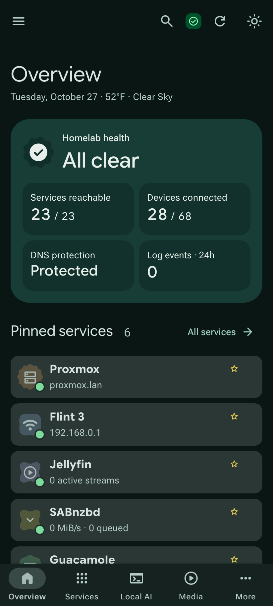
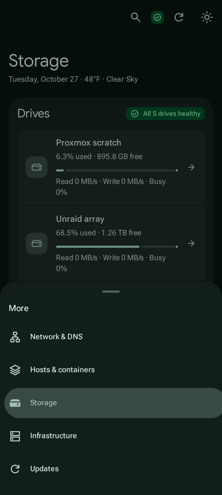
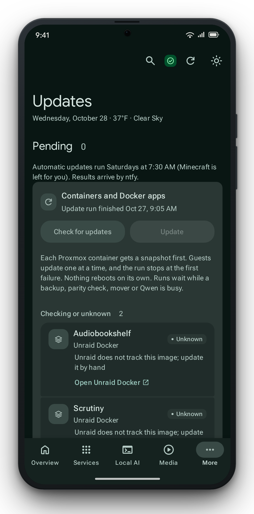

# Homelab Android App

A lightweight Android app for the [Homelab Command Center](https://github.com/roneill2000/homelab-dashboard). It runs the dashboard full screen with 120Hz scrolling, edge-to-edge system bar insets, and proper hardware back button support.

<p align="center">
  
  &nbsp;
  
  &nbsp;
  
</p>

---

## Download & install

The signed release APK is in [`release/Homelab-release.apk`](release/Homelab-release.apk) (3.73 MB).

- **Direct download:** [Homelab-release.apk](https://github.com/roneill2000/homelab-android/raw/main/release/Homelab-release.apk)
- **Install via ADB:**
  ```sh
  adb install -r release/Homelab-release.apk
  ```
- **Direct on phone:** download the APK and open it. Allow installing unknown apps if prompted.

### Verification

- **SHA-256:** `dec15f79ea96327351de5fc02789d3ad6a90fc5d716544ea7a0a40bcb6fb184a`
- **Signing:** signed with v1, v2, and v3 schemes (valid to 2054).

---

## Features

- **Full screen UI.** No browser address bars or navigation chrome.
- **120Hz display refresh.** Unlocks smooth high-refresh scrolling on supported phones.
- **Edge-to-edge layout.** Automatically fits around the camera cutout and gesture navigation bar without clipping content.
- **Predictive back.** On Android 14+ the back gesture previews closing the open sheet, dialog or search, then dismisses it before backing out of a page. On the Overview page it hands over to the system back-to-home animation.
- **Haptics.** Light tactile feedback on tab changes, sheet dismissals and quick actions.
- **Home-screen widget.** Leads with the gaming PC (asleep, idle, model loaded or generating, with GPU watts, temperature, load and VRAM), then downloads and a problems line that stays at "None" when all is well. Three sizes, refreshes every 15 minutes, keeps the last reading marked Away when you're not home. Material You colours on Android 12+.
- **Launcher shortcuts.** Long-press the icon for Network, Storage or Wake PC.
- **Native touches.** Status and navigation bars match the light or dark theme, and the splash stays until the dashboard has drawn.
- **Home dashboard only.** It loads the dashboard at `192.168.0.2`; plain HTTP is allowed to that address only, links to other sites open in your browser, and nothing is cached between launches.
- **Offline page.** If the dashboard can't be reached (away from home without the VPN), it shows a Try again screen instead of a browser error.
- **Locked-down release build.** No WebView remote debugging and no `adb backup` of app data.

---

## Building

Requires JDK 17+, Android SDK build-tools 35, and Node.js.

1. Install dependencies:
   ```sh
   npm install
   ```
2. Copy the keystore template:
   ```sh
   cp android/app/keystore.properties.example android/app/keystore.properties
   ```
3. Build release APK:
   ```sh
   cd android
   ./gradlew assembleRelease
   ```

---

## License

[MIT](LICENSE)
