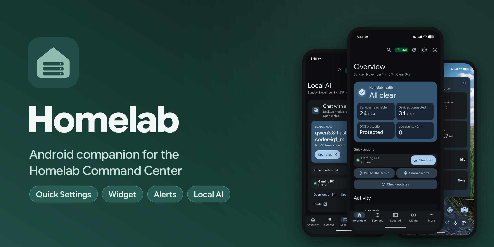
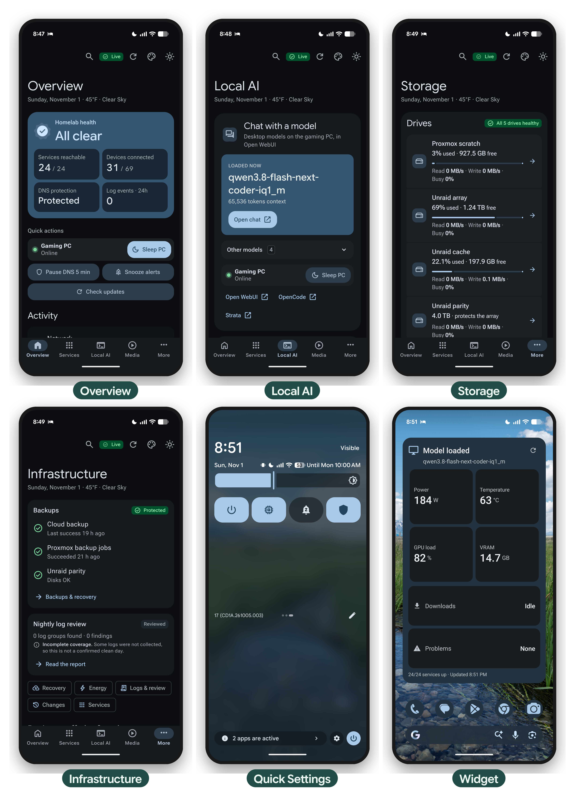
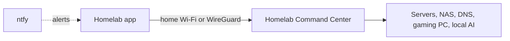

<div align="center">



<h1>Homelab for Android</h1>

**A native Android companion for the [Homelab Command Center](https://github.com/roneill2000/homelab-dashboard).**
Monitor, control and ask questions of a home lab from your phone, with Quick Settings tiles, a home-screen widget and instant alerts.

[](https://github.com/roneill2000/homelab-android/releases/latest)
[](#requirements)
[](#features)
[](LICENSE)

<a href="https://github.com/roneill2000/homelab-android/releases/latest/download/Homelab-release.apk"></a>

[Features](#features) · [Install](#install) · [Privacy](#privacy--security) · [Changelog](CHANGELOG.md)

</div>

<p align="center">
  
</p>

---

## Features

### At a glance
- **Full-screen dashboard** with 120 Hz scrolling, an edge-to-edge layout around the camera cutout and gesture bar, and no browser chrome.
- **Material You.** On Android 14+ the dashboard uses the system's own colour roles from your wallpaper, so it matches your other apps. Light and dark follow the system.
- **Home-screen widget** in four sizes: gaming PC state (asleep, idle, model loaded or generating, with GPU watts, temperature, load and VRAM), downloads and a problems line. It keeps the last reading, marked *Away*, when you are not home.

### One-tap control
| Quick Settings tile | Shows | Tap |
|---|---|---|
| **Gaming PC** | On / Asleep | Wake the PC |
| **DNS blocking** | On / Paused · minutes left | Pause for 5 minutes, or resume |
| **Snooze alerts** | Snoozed · time left | Snooze all homelab alerts for 2 hours, or end the snooze |
| **AI engine** | Strata / loaded model / Nothing loaded / PC asleep | Load Strata, or free the GPU (refused while a game runs) |

Every tile reads the live state when the panel opens and asks you to unlock first on the lock screen. Long-press the app icon for shortcuts to **Network**, **Storage**, **Wake PC** and **Ask AI**.

### Notifications
- **Alerts open the right page.** Homelab alerts arrive instantly through [ntfy](https://ntfy.sh); tapping one opens the app on the matching page.
- **Download progress.** An ongoing notification shows stage, percentage and speed while a download runs, then *Download finished*.
- **Answer ready.** Ask a question, leave the app, and get a notification with the start of the answer when it is done.

### Local AI
- **Ask AI from anywhere:** share text to Homelab, pick *Ask AI* in the text selection menu, or use the launcher shortcut. The question lands in the Ask box; nothing is sent until you choose the model and send.

### Native feel
- **Predictive back** on Android 14+: the gesture previews closing the open sheet, dialog or search before leaving a page.
- **Haptics** on tab changes, sheet dismissals and quick actions.
- **Offline page** that knows whether your VPN is on, opens WireGuard (or AmneziaWG), and reconnects by itself as soon as the dashboard answers.

---

## Privacy & security

- Talks **only to your own dashboard** on the home network. Plain HTTP is allowed to that single address; every other link opens in your browser.
- **No analytics, no accounts, no cloud.** Nothing is cached between launches.
- Release builds disable WebView remote debugging and `adb backup` of app data.
- Away from home, access goes through your own VPN (WireGuard); the dashboard is never exposed to the internet.



---

## Requirements

- Android **8.0 (API 26)** or newer; developed and tested on Android 15–17.
- A running [Homelab Command Center](https://github.com/roneill2000/homelab-dashboard) reachable from the phone (on the home network or over WireGuard).
- Optional: the [ntfy](https://ntfy.sh) app for instant alerts.

## Install

1. On the phone, download **Homelab-release.apk** from the [latest release](https://github.com/roneill2000/homelab-android/releases/latest) (3.7 MB) and open it. Allow installing from your browser if Android asks.
2. Or from a computer: `adb install -r Homelab-release.apk`

Updates install over the previous version (same signing key since 1.4). Every release lists the APK's SHA-256 so you can verify the download (`sha256sum Homelab-release.apk`); APKs are signed with schemes v1, v2 and v3 (certificate valid to 2054).

---

## Building from source

Requires JDK 17+, the Android SDK (build-tools 35) and Node.js.

```sh
npm install
export HOMELAB_SIGNING=/path/to/keystore.properties   # copy of android/app/keystore.properties.example, absolute storeFile
cd android && ./gradlew assembleRelease
```

The signing config is read from `$HOMELAB_SIGNING` and is never stored in the repository.

**Built with** [Capacitor](https://capacitorjs.com) around the dashboard, plus native Java for the widget, Quick Settings tiles, notifications, share targets and the offline page.

---

## License

[MIT](LICENSE)
